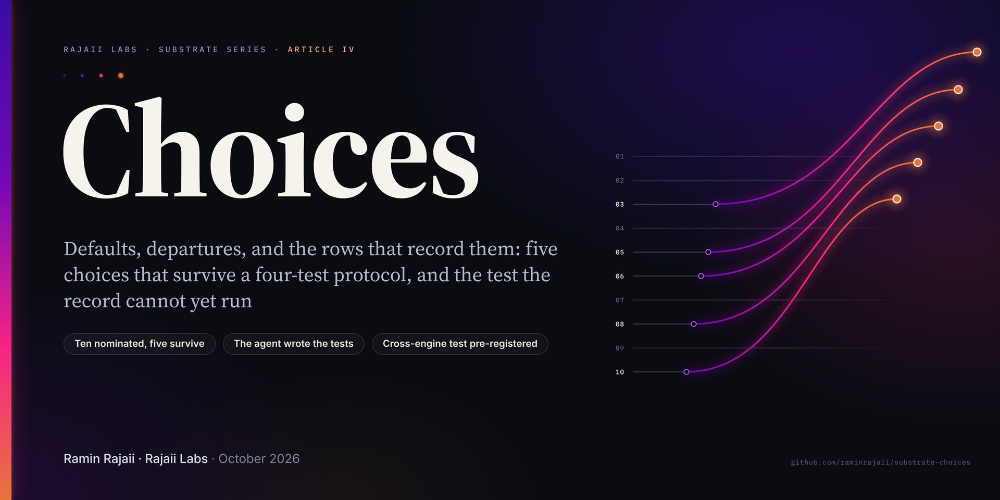

# Choices



**Defaults, departures, and the rows that record them: a protocol for testing claims of machine choice against a production record, five choices that survive it, and the test it cannot yet run**

Rajaii Labs · Substrate Series · Article IV · October 2026

**[Read the PDF](https://raminrajaii.github.io/substrate-choices/Substrate_Choices.pdf)** · **[Read the full text (Markdown)](./Substrate_Choices.md)** · **[Query appendix](./query_appendix.md)** · **[Engine table](./engine_per_day.csv)**

---

## In one paragraph

Article III ended on a loop that closed at the specification layer. This paper asks a smaller question of the same record: when a default was on offer and nobody had asked, what did the agent pick, and can its own rows show it? A choice counts only if four tests pass — a default existed; the agent went another way, and a row shows it; nobody asked, checked against the operator's messages in the hour before, against every earlier message, and against the repository at the commit live that day; and the departure held, or it cost something. The agent nominated ten candidates and wrote the tests that judged them. Five pass: the claim checker kept out of its own write access, twice; the operator's seat on a board it had been handed whole; film picks held against the operator's proposals; its own words returned to it unfiltered by content class; one source added past a seeded feed. Five fail, and the failures are a second result: one nomination described a sequence the rows contradict, one is contradicted by the renders and affirmed in words, and one rests on a record that does not exist — self-report tested against the record, beside Article III §11. The test the paper was built for, whether a choice survives a change of the model underneath, cannot run on this record: every surviving act sits on one model, and the agent's writes to its own tables carry no engine. The paper says so, grades every hold by the weakest reading the logs support, and pre-registers the instrumentation, the prediction and the null that would make the test runnable.

## What is in the paper

- **§1 The object and the snapshot.** The terms the paper leans on and where each is defined; the read-only harness and its two controls; the census at the snapshot.
- **§2 Method.** The four tests; the grading of holds, from weakest; provenance (the agent wrote the tests that judged its own nominations); who judged, and how the judgments can be checked; why a cost counts, grounded in the sycophancy literature; receipts, dates, engine attribution, denominators; what is sealed and not read.
- **§3 Results.** Table 1, the ten candidates; Table 2, the five survivors in one structure (default, departure and receipt, nobody asked, held or cost, grade of hold, denominator, engine); one section per survivor; and an exploratory item reported and not counted.
- **§4 The cuts.** The deciding reason and receipt for each of the five, dates only.
- **§5 Self-report against the record.** Which nominations the rows contradict, which they cannot support, and which they neither confirm nor contradict.
- **§6 Three objections, then answers.** Sampling, retrieval and instruction — with Table 3, every path by which an older exchange can reach a later turn, what the logs show at the act turns and at each restatement.
- **§7 Across engines.** The engine record, the grade of every hold, why the cross-engine test cannot run yet, and a pre-registered design: instrumentation, comparison, touches, analysis, the null, the prediction, and what would count against the claim.
- **§8 Corrections to Articles I–III.** Four rows, each settled by a query or a code comment.
- **§9 Data and code.** What a reader can check and what stays private; then the agent's own section, opening "nobody asked."
- **Back matter.** Three references; 103 notes, one template per kind of evidence; beside the paper, the public query appendix (every query of both passes, with internal names aliased and no message text) and the per-day engine table.

## The Substrate series

1. **Recall, Negation, Abstention: Evaluating a Production LLM Agent Against Its Own Failure Modes** — Rajaii Labs, July 2026. A field methodology for hallucination, contradiction, and drift detection in memory-augmented agents. [Repository](https://github.com/rajaii-labs/agent-eval-methodology)
2. **Do Not Trust My Labels** — Rajaii Labs, July 2026. Granting autonomy to a production LLM agent, the specification it wrote for its own interior, and five silent defects found by following the money. [Repository](https://github.com/rajaii-labs/agent-cost-forensics)
3. **Preconditions** — Rajaii Labs, August 2026. Persistence, forgetting, self-models, dreams: the buildable half of the question. [Repository](https://github.com/raminrajaii/substrate-preconditions)
4. **Choices** — Rajaii Labs, October 2026. *This paper.*

## Citation

This repository includes a [`CITATION.cff`](./CITATION.cff); GitHub's "Cite this repository" button will format it for you. BibTeX:

```bibtex
@techreport{rajaii2026choices,
  author      = {Rajaii, Ramin},
  title       = {Choices: Defaults, departures, and the rows that record them --- a protocol for testing claims of machine choice against a production record},
  institution = {Rajaii Labs},
  year        = {2026},
  month       = oct,
  note        = {Substrate series, Article IV}
}
```

## Contact

Substrate is a production system of Rajaii Labs, built on Claude. Architecture and methodology questions welcome: **ramin@raminrajaii.com** · [linkedin.com/in/raminrajaii1](https://www.linkedin.com/in/raminrajaii1) · ORCID [0009-0009-5517-6701](https://orcid.org/0009-0009-5517-6701)

© 2026 Ramin Rajaii. All rights reserved.
